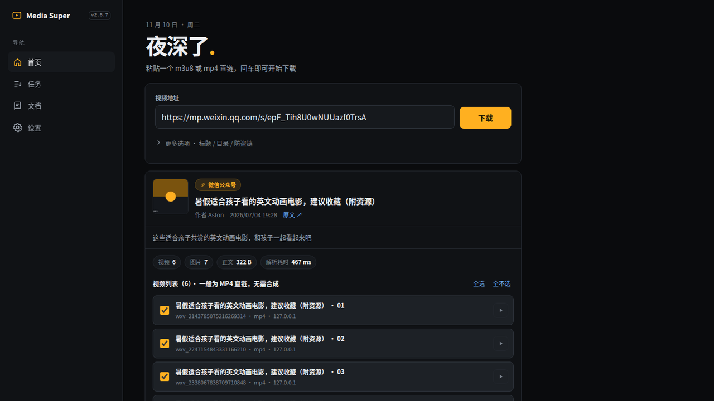
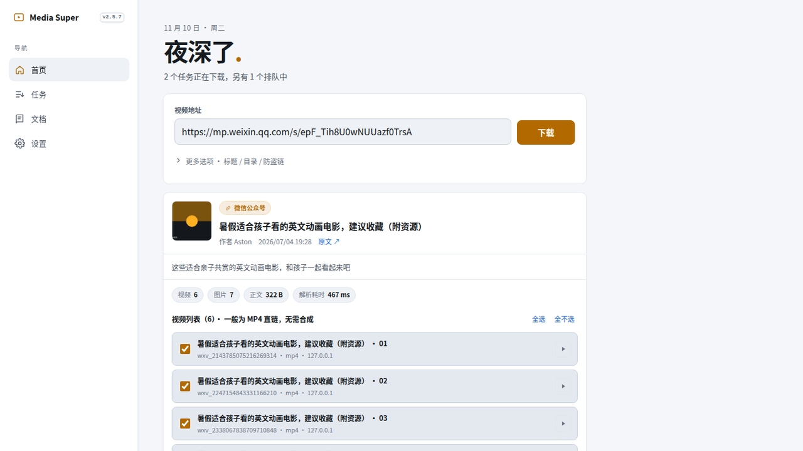
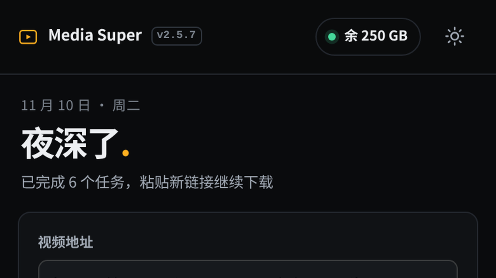
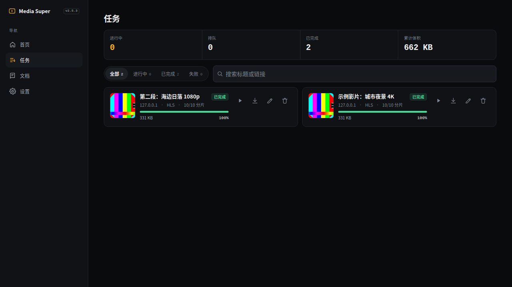
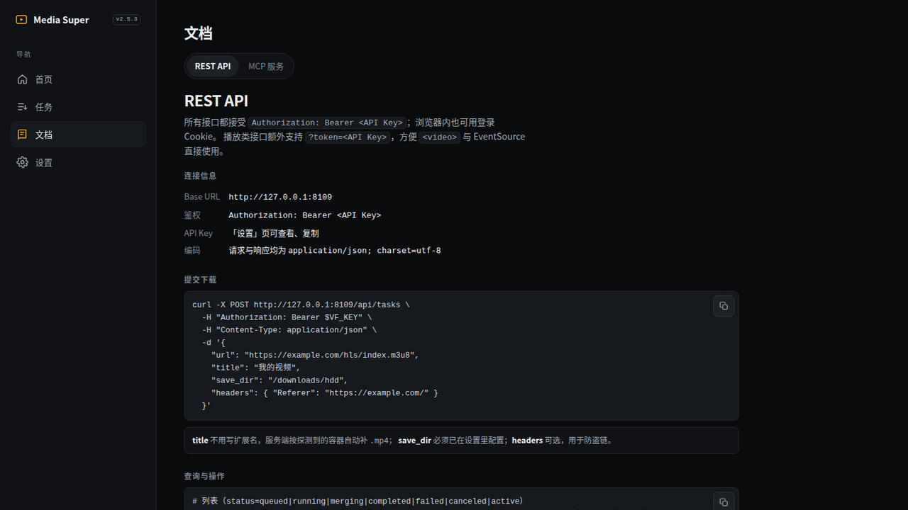

# Media Super

> 为低配 NAS 打造的视频下载器：**单 Go 二进制、常驻内存约 15MB、m3u8 多线程拉流 + 无损转封装成 mp4**。
> 自带 Web 管理台、REST API 与 MCP 服务，支持 Docker、飞牛 fnOS（fpk）与裸机运行。

## 功能

| 能力 | 说明 |
| --- | --- |
| 协议 | HLS(m3u8) / mp4 / flv / ts / mkv / webm / mov / 音频 |
| 链接解析 | 插件化：首页粘贴公众号文章 `mp.weixin.qq.com/s/*` 自动解析标题 / 封面 / 作者 / 简介 / 图片，把视频直链列成可勾选下载对象（一般 mp4、无需合成）；新增站点只需注册一个插件 |
| 下载 | m3u8 分片并发拉取（默认 8 连接）、直链 HTTP Range 多段并行，支持去除片头片尾 N 段 |
| 转封装 | ffmpeg `-c copy` 无损重封装为 mp4，编码不兼容时才降级转码；ffmpeg 作为运行时组件按需补齐，安装包保持 3MB 级 |
| 管理 | 四页导航（首页 / 任务 / 文档 / 设置）、SSE 实时进度、Webhook 回调、夜间与白天水波切换 |
| 更新 | 设置页「检查更新 / 一键更新」，优先 `gh-proxy.com`、异常自动直连；可开启每 2 小时自动检测、空闲时升级 |
| 部署 | Docker / docker compose / 裸机 / 飞牛 fnOS fpk，多架构 amd64 · arm64 · armv7 · armv6 · 386 |

## 安装（fnOS / FnDepot）

1. 在 FnDepot 客户端添加外部源：`https://github.com/Mr-losfer/media_downloads`
2. 在商店中找到 **Media Super**，按设备架构自动选择 x86 或 arm 安装包。
3. 安装向导里可自定义**管理员密码**与 **Web 端口**。
4. 安装完成后打开 `http://<NAS 地址>:<端口>` 即可使用。

- 默认密码：`losfer`（首次登录后请在「设置 → 安全」里修改）
- 默认端口：`9099`
- 最低系统版本：`0.9.0`
- 运行身份：`package`（存储空间，非 Docker 应用）

## 界面预览

## 相关链接

- 项目主页：https://github.com/Mr-losfer/media_downloads
- 问题反馈：https://github.com/Mr-losfer/media_downloads/issues
- 历史版本：https://github.com/Mr-losfer/media_downloads/blob/main/docs/RELEASES.md
- FnDepot 上架说明：https://github.com/Mr-losfer/media_downloads/blob/main/docs/FNDEPOT.md
